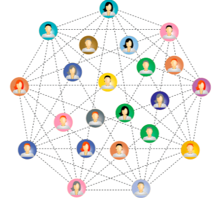

# Network Analysis with Python | NetworkX, Social Networks & Graph Algorithms

### Exploring Twitter Networks, GitHub Collaboration, Centrality Metrics, Communities, and Graph-Based Recommendations

**Project Type:** Educational Network Analysis and Data Science  
**Field:** Data Science | Graph Theory | Social Network Analysis | Graph Algorithms  
**Programming Language:** Python  
**Environment:** Google Colab | Jupyter Notebook  
**Author:** Data Engineer Luis Barahona

---
<div align="center">



*Social Network Analysis — Graph connectivity, nodes, and relationships.*

</div>

## 1. Project Overview

This project explores the fundamentals and practical applications of network analysis using Python, NetworkX, and nxviz.

Networks represent relationships between entities and provide useful tools for understanding complex systems such as social media platforms, transportation systems, communication networks, and collaborative environments.

The notebook combines graph theory concepts, visualization techniques, centrality metrics, pathfinding algorithms, community structures, and a practical case study involving GitHub collaboration networks.

Two primary datasets are used:

- An anonymized Twitter network.
- A GitHub user collaboration network.

The project is based on educational exercises from DataCamp's Introduction to Network Analysis in Python course, with Python implementations and experiments documented in Google Colab.

---

## 2. Project Objectives

The main objectives are to:

1. Understand the fundamentals of network analysis.
2. Represent relationships using nodes and edges.
3. Explore directed and undirected graphs.
4. Examine node and edge metadata.
5. Visualize networks through different graphical representations.
6. Calculate degree and betweenness centrality.
7. Implement graph traversal and pathfinding techniques.
8. Identify triangles and maximal cliques.
9. Analyze connected components and subgraphs.
10. Investigate collaboration patterns in GitHub networks.
11. Explore link recommendations using open triangles.
12. Apply graph analysis techniques to real-world network datasets.

---

## 3. Network Analysis Fundamentals

A network is a structure composed of nodes and edges.

### Nodes

Nodes represent entities such as:

- Social media users.
- Developers.
- Organizations.
- Transportation stations.
- Computers or servers.

### Edges

Edges represent relationships between entities.

Examples include:

- Social media connections.
- Software collaboration.
- Transportation links.
- Communication between systems.

### Directed Graphs

Directed graphs represent relationships with a specific direction.

```python
G = nx.DiGraph()
```

### Undirected Graphs

Undirected graphs represent relationships without a specified direction.

```python
G = nx.Graph()
```

### Graph Metadata

The notebook explores how additional information can be associated with nodes and edges.

Examples include:

- Connection dates.
- Node categories.
- User group membership.
- Numerical weights.

This information helps describe the structure and characteristics of a network.

---

## 4. Datasets

### 4.1 Twitter Network

The notebook uses an anonymized Twitter network dataset originally referenced through DataCamp.

**Dataset file:**

```text
ego-twitter.p
```

The saved notebook output reports:

**23,369 nodes**

The graph includes temporal metadata associated with connections.

This dataset supports exercises involving:

- Directed graph analysis.
- Node and edge inspection.
- Network visualization.
- Centrality metrics.
- Pathfinding.
- Triangle relationships.

### 4.2 GitHub Collaboration Network

The second dataset represents collaboration relationships among GitHub users.

**Dataset file:**

```text
github_users.p
```

In this network:

- Nodes represent GitHub users.
- Edges represent collaboration relationships.
- Node metadata includes grouping information.

The network supports the study of centrality, connected components, cliques, and potential collaboration recommendations.

### Dataset Loading

The notebook downloads the two datasets from DataCamp-hosted resources.

The data files are loaded using Python's pickle module.

```python
import pickle

with open(data_paths[0], "rb") as f:
    T = pickle.load(f)

with open(data_paths[1], "rb") as f:
    Gh = pickle.load(f)
```

**Security note:** Pickle files can execute arbitrary code during deserialization. Only load files from trusted and verified sources.

---

## 5. Technologies Used

| Technology | Purpose |
|:---|:---|
| Python | Programming language |
| NetworkX | Graph construction and analysis |
| nxviz | Specialized network visualization |
| Matplotlib | General data visualization |
| NumPy | Numerical matrix representations |
| Requests | Dataset downloads |
| pathlib | File and directory management |
| itertools | Combinatorial operations |
| collections | Counters and dictionaries |
| pickle | Loading serialized graph datasets |
| Google Colab | Cloud execution environment |
| Jupyter Notebook | Interactive documentation |

### Recorded Library Versions

The notebook's saved execution reports:

```text
NetworkX: 3.3
Matplotlib: 3.7.1
nxviz: 0.7.4
```

The nxviz library reports a deprecation warning for its older class-based visualization API.

The notebook uses the newer functional visualization interface in several exercises.

---

## 6. Network Exploration

The first practical section introduces the NetworkX API.

The exercises examine:

- Graph size.
- Node collections.
- Edge collections.
- Node metadata.
- Edge metadata.
- Graph direction.
- Edge weights.
- Self-loops.

### Example

```python
print(len(T))
print(type(T.nodes()))
print(list(T.edges(data=True))[-1])
```

This provides information about the structure and metadata of the Twitter network.

The notebook also demonstrates how to select a smaller subgraph for visualization.

---

## 7. Network Visualization

The project explores multiple network visualization techniques.

### 7.1 Standard NetworkX Visualization

NetworkX provides basic plotting functions for displaying nodes and edges.

```python
nx.draw(T_sub, with_labels=True)
plt.show()
```

This method is useful for small networks.

### 7.2 Matrix Plot

A matrix plot represents connections as entries in an adjacency matrix.

Rows and columns correspond to nodes.

Filled cells indicate relationships between node pairs.

The notebook also explores converting graphs into numerical matrices.

```python
A = nx.to_numpy_array(G)
```

### 7.3 Circos Plot

A Circos plot arranges nodes around a circle and draws connections between them.

This visualization can reveal:

- Dense connection patterns.
- Node groupings.
- Network structure.
- Relationships between categories.

### 7.4 Arc Plot

An Arc plot positions nodes along a line and represents connections with arcs.

Node metadata can be used to control grouping, sorting, and colors.

### Visualization Library

The notebook uses nxviz for specialized network plots.

```python
import nxviz as nv
```

Examples include:

```python
nv.matrix(G)
nv.arc(G)
nv.circos(G)
```

The visualization functions may require adjustments depending on the installed nxviz version.

---

## 8. Degree Centrality

Degree centrality measures how many connections a node has relative to the number of possible connections.

For an undirected graph with n nodes:

```text
Degree Centrality = Degree(node) / (n - 1)
```

### Python Implementation

```python
degree_scores = nx.degree_centrality(G)
```

### Applications

Degree centrality can help identify:

- Highly connected users.
- Important collaborators.
- Influential network participants.
- Network hubs.

The notebook also visualizes the distribution of degree centrality scores.

### Recorded Twitter Experiment

The saved output identifies:

```text
Node 11824
```

as the node with the highest degree centrality in the corresponding Twitter network experiment.

This identifier belongs to the anonymized research dataset.

---

## 9. Betweenness Centrality

Betweenness centrality measures the extent to which a node lies along shortest paths connecting other nodes.

Nodes with high betweenness centrality can act as bridges between different areas of a network.

### Python Implementation

```python
betweenness_scores = nx.betweenness_centrality(G)
```

### Potential Applications

- Identifying intermediary nodes.
- Understanding information pathways.
- Studying network connectivity.
- Detecting structural bridges.
- Exploring communication bottlenecks.

### Recorded Twitter Experiment

The notebook's saved output identifies:

```text
Node 3265
```

as the node with the highest betweenness centrality in the analyzed Twitter graph.

The project also compares degree centrality and betweenness centrality through scatter plots.

These measures capture different aspects of node importance.

---

## 10. Graph Traversal and Pathfinding

Pathfinding is a fundamental graph analysis task.

It determines whether one node can be reached from another through a sequence of connections.

### Breadth-First Search

The notebook explores Breadth-First Search (BFS) as a method for traversing graph relationships.

The exercises build a function called:

```python
path_exists(G, node1, node2)
```

Its purpose is to test whether a path exists between two specified nodes.

### Main Procedure

1. Initialize a collection of visited nodes.
2. Add the origin node to a queue.
3. Examine neighboring nodes.
4. Check whether the destination is reachable.
5. Add unvisited neighbors for further exploration.
6. Return a Boolean result when the search is complete.

### Applications

Pathfinding is relevant to:

- Transportation networks.
- Communication systems.
- Social network connections.
- Dependency graphs.
- Connected-data exploration.

The notebook focuses on introductory pathfinding and reachability rather than weighted route optimization.

---

## 11. Communities, Triangles, and Cliques

Network structures can reveal groups of closely related nodes.

### Triangles

A triangle is formed when three nodes are mutually connected.

Triangle analysis helps examine local connectivity and group structures.

### Open Triangles

An open triangle occurs when two nodes share a common neighbor but are not directly connected to each other.

Example:

```text
User A ----- User B
   |
   |
User C

User B and User C are not directly connected.
```

An open triangle can represent a potential missing relationship.

### Recorded Result

The saved Twitter analysis reports:

**908 nodes involved in open-triangle relationships.**

This result comes from the notebook's specific graph experiment.

### Cliques

A clique is a group of nodes in which every node is directly connected to every other node.

### Maximal Cliques

A maximal clique cannot be expanded by adding another adjacent node while preserving complete connectivity.

The notebook explores maximal cliques using:

```python
nx.find_cliques(G)
```

These structures are useful for investigating tightly connected groups.

---

## 12. Subgraphs and Connected Components

The notebook explores how larger networks can be divided into smaller structures.

### Subgraphs

A subgraph contains a subset of nodes and their associated connections.

```python
subgraph = G.subgraph(selected_nodes)
```

### Connected Components

A connected component is a group of nodes in which every node can reach every other node through a path.

The notebook uses:

```python
nx.connected_components(G)
```

### Applications

Connected components can help identify:

- Isolated groups.
- Collaboration clusters.
- Independent communities.
- Separate network structures.

The experiments demonstrate how smaller connected structures can be extracted and visualized independently.

---

## 13. GitHub Collaboration Network Case Study

The final notebook section applies network analysis techniques to a GitHub collaboration dataset.

### Research Questions

The case study investigates:

1. Which users have the greatest number of collaboration relationships?
2. Which users are structurally important to the network?
3. What tightly connected groups exist?
4. How can potential new collaboration relationships be identified?

### Graph Construction

The GitHub collaboration network is converted into an undirected graph.

```python
G = nx.Graph(Gh)
```

### Network Characterization

The exercises examine:

- Number of nodes.
- Number of edges.
- Degree centrality distribution.
- Betweenness centrality distribution.
- Connected components.
- Cliques.

### Collaboration Visualization

The notebook applies Matrix, Arc, and Circos plots to visualize the structure of GitHub collaboration networks.

User group metadata is used to organize some of the graphical representations.

---

## 14. Identifying Important Collaborators

The case study uses degree centrality to identify highly connected GitHub users.

### Example

```python
degree_scores = nx.degree_centrality(G)

maximum = max(degree_scores.values())

important_users = [
    node
    for node, score in degree_scores.items()
    if score == maximum
]
```

The exercise identifies users with the maximum degree centrality score in the analyzed network.

This provides a simple structural indicator of collaboration activity.

It does not directly measure code quality, expertise, or professional influence.

---

## 15. Collaboration Recommendations

The final exercise explores graph-based collaboration recommendations.

### Core Idea

If two users share one or more collaborators but have not collaborated directly, their relationship forms an open triangle.

This structure can be used to identify potential future collaboration pairs.

### Recommendation Procedure

1. Examine each node in the collaboration graph.
2. Identify pairs of neighboring nodes.
3. Check whether each pair already has an edge.
4. Count shared-neighbor relationships for unconnected pairs.
5. Rank candidate pairs according to their counts.

### Python Concepts

The notebook uses:

```python
from itertools import combinations
from collections import defaultdict
```

These utilities help generate neighbor pairs and count potential recommendations.

### Recommendation Interpretation

The procedure demonstrates a structural link-recommendation heuristic.

It does not implement a complete recommendation platform.

The notebook does not include:

- A predictive train-test split.
- Precision or recall for recommended links.
- User preference modeling.
- A deployed recommendation API.
- Validation of future collaboration outcomes.

Therefore, its outputs represent potential collaboration candidates, not verified successful recommendations.

---

## 16. Recorded Experimental Findings

The notebook includes several saved execution results.

| Experiment | Recorded Finding |
|:---|:---|
| Twitter graph size | 23,369 nodes |
| Highest degree centrality | Node 11824 |
| Highest betweenness centrality | Node 3265 |
| Open-triangle participation | 908 nodes |
| GitHub case study | Collaboration and clique analysis |
| Recommendation experiment | Candidate relationships based on open triangles |

The results demonstrate the analytical workflow for the specific datasets and graph representations used.

They should not be generalized to the current Twitter/X or GitHub platforms.

---

## 17. How to Run

### Google Colab

[Open the Network Analysis Notebook](https://colab.research.google.com/drive/1V1BjF2D5weiH8KrSa7YwQwU6aoke-HLk)

### Requirements

- Python 3
- NetworkX
- nxviz
- Matplotlib
- Requests
- NumPy
- Google Colab or Jupyter Notebook

### Install Dependencies

```bash
pip install networkx nxviz matplotlib numpy requests notebook
```

### Execution Steps

1. Open the notebook in Google Colab.
2. Install the required libraries.
3. Execute the import cells.
4. Download the referenced datasets.
5. Load the Twitter and GitHub graphs.
6. Explore network properties.
7. Generate graph visualizations.
8. Calculate degree and betweenness centrality.
9. Execute pathfinding exercises.
10. Explore triangles and maximal cliques.
11. Analyze the GitHub collaboration network.
12. Generate potential collaboration recommendations.

### Reproducibility Considerations

The notebook uses external datasets and specialized visualization functions.

Changes in library APIs or dataset availability may require adjustments.

Some later exercises reuse and redefine graph variables.

Run the notebook in sequence and verify each intermediate graph before interpreting the results.

---

## 18. Important Limitations

This is an educational network analysis notebook.

### Historical Datasets

The Twitter and GitHub datasets represent historical network snapshots, not live platform data.

### Data Provenance

The exercises and datasets originate from external educational resources, including DataCamp.

### Visualization Compatibility

Some nxviz functions may behave differently across library versions.

### Graph Variable Reuse

Several sections reuse variable names for different graphs, making execution order important.

### Computational Complexity

Centrality and clique calculations can become computationally expensive on large networks.

### Recommendation Validation

The open-triangle procedure does not include an independent evaluation of recommendation quality.

### Network Interpretation

A high centrality score represents a structural property of the graph and does not necessarily imply authority, expertise, or real-world influence.

---

## 19. Future Improvements

Potential developments include:

- Organizing the code into reusable Python modules.
- Adding graph validation and automated tests.
- Implementing consistent dataset loading.
- Pinning compatible library versions.
- Benchmarking centrality algorithms.
- Comparing additional community detection algorithms.
- Implementing link prediction metrics.
- Evaluating recommendation precision and recall.
- Adding interactive network visualizations.
- Creating a GitHub collaboration analytics dashboard.
- Extending experiments to larger networks.
- Building a reproducible graph analysis pipeline.

---

## 20. Practical Applications

The techniques explored in this project may support:

- Social Network Analysis.
- Collaboration analytics.
- Organizational network research.
- Community detection.
- Recommendation systems.
- Knowledge graphs.
- Transportation network studies.
- Communication network analysis.
- Graph-based Data Science.

---

## 21. Project Resources and Attribution

### Google Colab Notebook

[Open the Original Notebook](https://colab.research.google.com/drive/1V1BjF2D5weiH8KrSa7YwQwU6aoke-HLk)

### DataCamp

[DataCamp — Online Data Science Learning](https://www.datacamp.com/)

The notebook is based on educational course material and exercises from Introduction to Network Analysis in Python.

The source datasets are hosted on DataCamp infrastructure.

### NetworkX Documentation

[NetworkX — Python Graph Analysis](https://networkx.org/documentation/stable/)

### nxviz

[nxviz — Network Visualization](https://nxviz.readthedocs.io/)

### Important Attribution

This repository documents educational exercises and practical implementations.

The original educational materials, externally hosted datasets, and third-party graphics remain attributable to their respective creators and publishers.

Course content and certifications should not be represented as independently authored material or as proof of credentials not personally earned.

---

## 22. Conclusion

This project explores network analysis using Python, NetworkX, and nxviz through practical experiments involving Twitter and GitHub collaboration datasets.

The notebook demonstrates how graph structures can be analyzed to understand connectivity, node importance, paths, communities, and potential relationships.

Degree and betweenness centrality provide complementary measures of structural importance, while triangles and cliques reveal local network organization.

The final GitHub collaboration exercise introduces a simple link-recommendation approach based on shared neighbors and open triangles.

Overall, the project provides a foundation for further studies in Graph Theory, Social Network Analysis, Network Science, and Graph-Based Machine Learning.

---

## Author

**Data Engineer Luis Barahona**

Mexican Data Engineer and 2026 graduate of Universidad del Caribe, interested in Data Engineering, Data Science, Artificial Intelligence, Graph Theory, and continuous professional development.

---

## Contact

| Platform | Contact |
|:---|:---|
| Email | [190300395@ucaribe.edu.mx](mailto:190300395@ucaribe.edu.mx) |
| GitHub | [github.com/LuisBarahonaMX](https://github.com/LuisBarahonaMX) |
| LinkedIn | [linkedin.com/in/luis-barahona-mx](https://www.linkedin.com/in/luis-barahona-mx/) |
| Instagram | [@luisbarahonamx](https://www.instagram.com/luisbarahonamx/) |
| X | [@luisbarahonaMX](https://x.com/luisbarahonaMX) |
| Website | [SIKO AI Platform](https://sikoai.web.app/) |
